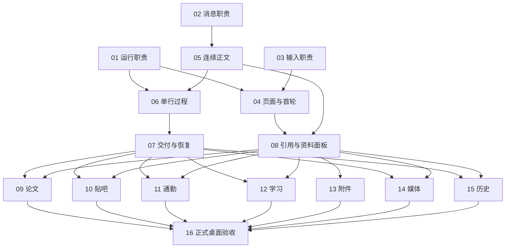

# 对话页面改版：正式工单索引

- 日期：2026-10-17（Asia/Shanghai）
- 当前状态：用户已确认「发布」；16 票正式工单均为 ready-for-agent，业务开发尚未开始。
- 任务范围：[PRD 与共同验收约束](PRD.md)
- 设计依据：[设计原则 0005](../../docs/design/0005-continuous-conversation-and-on-demand-details.md)、[ADR-0044](../../docs/adr/0044-continuous-conversation-presentation.md)
- 已批准原型：[页面入口](../chat-prototype/dist/index.html)、[原型检查结果](../chat-prototype/verification.json)

## 正式工单

1. **[整理对话运行职责，保持发送与恢复行为](issues/01-conversation-lifecycle.md)**
   - 阻塞：无。
   - 交付：用户发送、停止、重试、刷新和切换会话时仍得到与改造前一致的结果，为后续布局改版提供稳定的运行边界。

2. **[整理消息呈现职责，保留全部结果投影](issues/02-message-presentation-boundaries.md)**
   - 阻塞：无。
   - 交付：当前与历史消息继续完整可读，正文、过程、状态、引用和操作具有清晰的呈现边界，使后续改版能替换容器而不丢数据。

3. **[整理输入区职责，保持发送、附件与听写能力](issues/03-composer-boundaries.md)**
   - 阻塞：无。
   - 交付：用户仍能输入、换行、添加附件、选择现有模块及使用已有听写能力；输入区可以在后续改版中调整布局而不重写发送逻辑。

4. **[交付新对话布局与真实首轮发送](issues/04-desktop-shell-first-turn.md)**
   - 阻塞：01、03。
   - 交付：用户进入新的简洁桌面对话页，在输入区选择模式、发送第一条消息，并自然进入同一风格的正式会话。

5. **[让普通回答形成连续可阅读正文](issues/05-continuous-answer.md)**
   - 阻塞：02。
   - 交付：用户在真实流式回答和历史回答中连续阅读段落、标题、列表及已有富内容，用户消息保留气泡，助手正文不被外层卡片包裹。

6. **[用单行真实进度集中呈现公开过程](issues/06-public-progress.md)**
   - 阻塞：01、05。
   - 交付：用户生成回答时默认只看到一行真实进度，可主动展开查看公开步骤、来源说明和本轮上下文使用情况。

7. **[内联呈现交付状态、失败与真实恢复](issues/07-delivery-and-recovery.md)**
   - 阻塞：06。
   - 交付：用户直接分辨哪些内容已交付、哪些尚未完成，并能在对应位置执行真实可用的停止、重试或补充操作，而无需阅读本轮结果卡片。

8. **[从真实引用打开右侧资料并继续对话](issues/08-citation-viewer.md)**
   - 阻塞：04、05。
   - 交付：用户点击回答中的真实引用，在默认关闭的右侧面板查看对应资料；仍能阅读和继续原对话，并在资料不可访问时获得明确反馈。

9. **[把论文发现结果融入正文与资料阅读](issues/09-paper-answer.md)**
   - 阻塞：07、08。
   - 交付：用户直接读到围绕研究问题组织的论文推荐与阅读顺序，按需查看论文依据、摘要和真实读取范围，检索过程不再占据整块功能卡片。

10. **[恢复贴吧总结正文并按需查看帖子依据](issues/10-tieba-answer.md)**
   - 阻塞：07、08。
   - 交付：用户首先读到围绕话题组织的总结，点击引用再查看帖子与回复；网友体验、官方规定和未读内容的边界清楚可见。

11. **[把通勤建议、地图与澄清融入对话](issues/11-commute-answer.md)**
   - 阻塞：07、08。
   - 交付：用户直接获得出发与到达建议，地图和关键路线信息紧邻相关论述；地点不确定或路线不可得时能在对话中完成澄清。

12. **[让学习讲解与实际作答反馈连续呈现](issues/12-learning-conversation.md)**
   - 阻塞：07、08。
   - 交付：用户在同一消息流中阅读讲解、作答、收到反馈并选择继续、跳过或暂停，学习状态与依据按需查看，不由教学卡片主导阅读。

13. **[保留附件上传并在对话旁查看真实文件](issues/13-attachments-preview.md)**
   - 阻塞：08。
   - 交付：用户上传文件或照片、看到真实处理状态，发送后能从消息附件打开可支持的预览或原件，而不离开正在进行的对话。

14. **[在正文中交付图片与视频并保留生成状态](issues/14-media-results.md)**
   - 阻塞：07、08。
   - 交付：用户在相关解释旁看到真实生成的图片或视频，能够预览、播放或下载，并清楚知道尚在生成、失败或产物不可用。

15. **[以新呈现读取旧结果，保持退役能力关闭](issues/15-historical-results.md)**
   - 阻塞：07、08。
   - 交付：用户能够在新页面阅读过去的结果和失败尝试，旧数据不会丢失，也不会因重新展示历史而重新启动已经退役的能力。

16. **[完成真实桌面验收并更新交付状态](issues/16-desktop-acceptance.md)**
   - 阻塞：09、10、11、12、13、14、15。
   - 交付：用户在正式应用中获得与已批准原型一致且功能完整的对话体验，生产交付有可复核证据，不能以静态演示或全接口 mock 代替。

## 依赖关系

仅列直接阻塞，传递依赖不重复列出。01／02／03 是分别可验证的前置整理；后续票不按编号盲目串行，而是只在直接阻塞均通过后开始。

## 按批次并行执行建议

以下按现有阻塞关系划分为 6 批，适合协调者分批派发。表中并行表示依赖允许，实际还须确认修改范围不冲突。批次是调度建议，不新增工单依赖；某票的全部直接阻塞已验收并集成到其开发基线后，可以提前领取，无需等待上一批的无关任务。

| 批次 | 可并行工单 | 启动条件 | 本批交接重点 |
| --- | --- | --- | --- |
| 第 1 批：整理现有职责 | 01 运行职责、02 消息呈现、03 输入区 | 无工单阻塞；先确认现有行为基线和各自修改边界 | 保持发送、历史和输入行为；明确状态所有者、消息呈现边界与输入接口，避免三票同时重构页面组合 |
| 第 2 批：页面与正文 | 04 新布局与首轮、05 连续正文 | 04 等待 01、03；05 等待 02 | 新布局能真实发送，正文能流式显示与读取历史；统一正文宽度、滚动容器和输入区布局约定 |
| 第 3 批：过程与资料 | 06 单行公开进度、08 引用资料面板 | 06 等待 01、05；08 等待 04、05 | 过程和面板默认收起；明确进度、引用入口及资料请求生命周期，验证并排阅读与继续提问 |
| 第 4 批：恢复与附件 | 07 交付状态与恢复、13 附件预览 | 07 等待 06；13 等待 08 | 分别验证停止／失败／重试和上传／处理／预览；附件状态与资料面板接入保持一致 |
| 第 5 批：各领域完整场景 | 09 论文、10 贴吧、11 通勤、12 学习、14 媒体、15 历史结果 | 每票均等待 07、08；不依赖 13 | 各票自行验收真实完整路径；统一接入正文、资料和恢复能力，保留领域差异及历史只读边界 |
| 第 6 批：整体验收 | 16 正式桌面验收 | 09、10、11、12、13、14、15 全部验收并集成 | 跨场景回归、桌面视觉和可访问性、完整检查及构建，按实际结果更新交付文档 |

建议同时安排 2～3 个开发执行者，由一名协调者维护领取记录和集成顺序。第 5 批若只有 3 个开发执行者，可先分配 09／10／11，空出的执行者继续领取 12／14／15；这是容量安排，后三票不依赖前三票。某票遇到阻塞时，优先转向其他已满足依赖的票，不用未完成的接口或模拟成功结果绕过阻塞。

并行执行时遵守以下交接规则：

1. **领取前明确边界。** 在对应工单 Comments 中记录执行者、工作分支或工作目录、预计修改范围及依赖验收依据。共享的页面组合、消息列表、全局样式和资料面板入口，在同一时段指定一个修改负责人；其他执行者先约定接入方式。
2. **隔离修改，避免覆盖。** 优先使用独立分支和独立工作目录。若共用一个工作区，只并行修改已约定互不重叠的文件；一旦出现重叠，协调调整顺序。独立分支也不免除接口协调和合并后的验证。
3. **共享能力先协调。** 第 3 批重点协调正文中的过程与引用入口；第 5 批复用已完成的正文、资料和恢复能力。若发现公共能力缺口，明确一个负责人完成必要修改，其他票等待该变更验收；确属新的强依赖时，同步工单与依赖图。
4. **逐票验收并集成。** 每票先完成自身标准与检查，再由协调者逐票集成，针对实际冲突或组合风险验证。交接包含实际行为、验证结果、未验证限制与后续接入约定；“代码已写”或分支内通过不代表后续票已可使用。
5. **最后集中整体验收。** 16 由一个负责人汇总执行，领域执行者配合复现和修复。前序票各自承担验证，第 6 批补充组合验收；所有必要结果齐备前不把整组任务标为完成。

## 发布记录与领取规则

2026-10-17，用户确认「发布」，批准本次任务粒度与阻塞关系。16 票已逐票发布到本功能的 issues 目录，每票一个 Markdown 文件，状态均为 ready-for-agent；草案已移入正式目录，不保留重复执行入口。

当前可立即领取的是 01、02、03。其他工单仅在全部直接阻塞完成验收后领取；ready-for-agent 表示任务规格已经批准，不表示前置任务已经完成。本次发布仅发布本地开发工单，不启动业务开发或部署。

无依赖不等于任意共享工作区都能同时改文件。各执行者开始前检查当前改动与相关票的实际完成状态，避免覆盖其他人的工作；如果实际发现新的强依赖，先更新工单依据，不用隐藏前置条件制造假完成。

