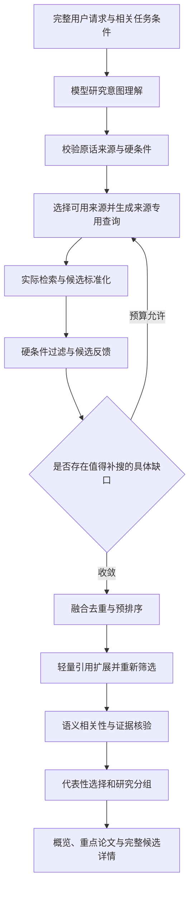

# 日常陪伴论文搜索改进方案

日期：2026-10-11（Asia/Shanghai）

状态：已实施；论文搜索范围的回归、前端合同和真实来源查询已完成验收。全仓后端检查仍有论文范围外失败，详见 [HANDOFF.md](HANDOFF.md)。

## 1. 目标与范围

将日常陪伴中的论文搜索改为研究问题驱动的文献发现能力，参考本地 `D:\参考项目\paperseek-main` 的实际工作流，支持主题探索、开题和综述的第一轮文献发现。

保留聊天入口与能力结果详情。模块收到研究请求后默认直接检索；关键歧义影响结果时只问一个问题。用户可在后续对话中修改年份、主题或来源，按跨轮任务与任务版本继续执行。

首版优先覆盖国际学术来源，支持中文问题理解、中英检索概念转换及中文解释；来源中的中文论文正常保留，不承诺中文期刊与学位论文的完整覆盖。

首版交付以实际取得的标题、摘要和来源元数据为依据；全文精读、实验比较、研究结论的系统综述不是此次已确认的默认能力。全文链接与实际读取范围分别表达。

## 2. 已确认的产品选择

| 事项 | 用户确认的选择 |
| --- | --- |
| 定位 | 研究问题驱动的文献发现 |
| 入口 | 默认直接检索，必要时澄清，范围可见且可纠正 |
| 来源 | 按领域自动选择 2–3 个可用且互补的来源，支持指定或排除 |
| 语言与覆盖 | 中文提问与解释，国际学术来源优先 |
| 深度 | 标准探索，60–90 秒为设计预算目标，显示真实进度并可停止 |
| 组织 | 研究概览与按子问题或方法路线分组，完整候选按需展开 |
| 引用 | 在预算内默认轻量引用扩展，扩展候选重新筛选，关系图按需展开 |
| 数量 | 重点 5–8 篇，完整候选目标 20–30 篇；不足时如实交付 |
| 宽泛主题 | 默认代表性概览，兼顾综述、代表性方法和后续进展 |
| 相关性呈现 | 直接相关／覆盖部分问题／探索线索，附需求对应的证据理由 |
| 首次理解失败 | 明确失败、保留请求并允许重试 |
| 部分来源或引用失败 | 交付已核验结果，说明缺口并支持补搜 |

这些数量是默认目标。用户明确指定篇数时优先遵守其要求；候选集合不通过弱相关论文凑数。60–90 秒是待实测校准的设计预算，不是已达成的性能承诺。

用户特别指出：词表英文转换是当前不满意的核心问题之一，固定词表带来明显能力局限。本次改造必须退出词表驱动的意图解析、翻译和消歧主路径。

## 3. 当前实现的实证问题

在 conda `agent` 环境只运行本地解析与查询规划，未执行外部论文搜索：

| 原始请求 | 当前结果 | 问题 |
| --- | --- | --- |
| 请给我几篇与卷积神经网络有关的论文 | `卷积神经网络`，预设第二次 `title:卷积神经网络` | 缺少常见英文检索概念；补搜没有根据实际缺口调整 |
| 请给我几篇用深度学习做轴承故障诊断的论文 | `deep learning` | 丢失轴承故障诊断问题 |
| 请给我近三年用 Transformer 进行交通流预测的论文 | 固定询问模型或变压器 | 现有语境词表未充分理解完整应用场景 |
| 请给我几篇利用卷积神经网络解决小样本图像分类的论文 | `image classification` | 丢失卷积网络方法和小样本条件 |

其他代码事实：候选检索仅接入 arXiv，Crossref/OpenAlex 只补元数据；规划请求量可达 15，但来源封装实际限到 10；推荐上限为 5；两次查询择优保留，未融合全部有效候选；生产装配未注入全文阅读器。

## 4. PaperSeek 实际流程与采用方式

本地参考版本的主流程：完整请求 → 模型意图分析 → 来源专用查询生成及校验 → 实际检索与有界反馈调整 → 多路召回及融合预排序 → 引用扩展及去重 → 批量模型相关性重排 → 结果、查询历史与引用图。

重要边界：一次搜索主要使用一个选定来源；多路召回是在该来源支持的不同路径内进行；引用扩展仅在 OpenAlex 来源下启用；意图分析失败会继续查询；部分放宽提示词允许移除年份等条件。

BridGes 采用完整意图分析、来源专用查询、真实反馈、有界循环、候选融合和引用扩展的思路，并按第 2 节的选择改为少量多源联合检索、首次理解失败即停以及确定性硬条件校验。

## 5. 新版流程与职责

### 5.1 研究意图理解

输入为完整原话、当前任务条件及必要消歧上下文。尽量复用父图已有的有效理解产物；需要新的论文理解调用时，纳入登记模型网关和共享运行预算。

结构化产物保留研究对象、问题、方法、应用场景、阅读目的、用户限制、检索概念及同义表达。用户明确条件关联原话片段；译名和推导的检索词记录对应概念。模型推断的阅读偏好与明确硬条件分别标记。

词表不再决定主题抽取、是否可翻译、允许哪些研究方向或何时必须消歧。未知术语和多概念组合可以直接进入语义理解。代码仍负责结构、对象归属、来源、时间等明确约束的校验。

### 5.2 查询规划与来源适配

模型依据研究意图和已登记来源能力提出查询；代码核对来源可用性、原始范围、硬条件、查询格式和预算，再交给来源适配器执行。

首版来源接入清单在实现前依据现有依赖、PaperSeek 适配器、官方接口文档和真实可用性确定；不得把参考项目的全部来源列表直接视为已接入能力。按领域选择 2–3 个可用来源；可用来源不足时说明实际范围。明确指定或排除的来源优先。

外发只包含任务必要的公开检索概念和过滤条件，不发送完整聊天、私人材料或无关画像。凭据继续由既有配置与授权边界持有。

### 5.3 结果反馈与有界调整

反馈包含实际查询、已取得候选、硬条件过滤结果、语义匹配样本及缺失子问题。补搜必须针对具体缺口，保留研究对象和明确条件。

在共享预算内有限调整；无实质查询变化、没有新增有效候选、已经满足目标或预算耗尽时收敛。循环由代码控制，模型只能提出受校验的下一步。查询记录与有效候选都保留，后续查询不覆盖前轮有效结果。

### 5.4 候选融合与引用扩展

来源响应转换为独立的候选模型，身份以 DOI、arXiv、来源原生 ID 等关联，保留各来源记录与发现路径。来源响应、领域候选和前端投影在边界处转换，不跨层共享可变状态。

按来源实际能力融合相关度、影响力和时效等召回路径。引用量只作发现与辅助信号，不直接认定相关性、论文质量或奠基地位。

引用扩展以少量相关候选为起点，受来源支持、身份核验与剩余预算约束；取得真实引用边后才能绘图。扩展候选重新执行硬条件和相关性筛选，并明确其引用方向与发现来源。

### 5.5 证据评估与交付

批量语义评估将论文对应到研究需求，给出相关性分档、已取得的支持片段与未覆盖部分。模型给出的引用必须能定位到实际标题、摘要或已读材料。

宽泛主题按本轮证据组织代表性概览；具体研究问题按子问题或方法路线组织。概览描述本轮检索结果，不宣称完整覆盖整个领域；未找到某项文献只说明本轮缺口。

普通请求默认重点 5–8 篇、完整候选目标 20–30 篇，明确数量和范围优先。标题线索、摘要支持的推荐以及实际读取全文的状态分别表达。

聊天正文给出精简研究概览和重点推荐；能力结果详情提供完整候选、分组、来源、年份、匹配证据、链接与查询过程。引用图按需展开并有列表等价路径。固定进度与错误文案反映实际状态，不显示内部提示词、原始思维链或运行账本字段。

## 6. 失败、停止与跨轮延续

- 首次意图理解无法得到有效产物：停止后续检索，明确失败并提供重试；不自动回退到旧词表主路径。
- 单个来源失败或引用扩展失败：保留其他来源已核验结果，记录缺失范围；没有有效结果时给真实空结果或失败原因。
- 预算耗尽：停止新增工作，交付通过质量门的部分及未完成项；未经相关性和证据核验的候选不能充作已核验推荐。
- 用户停止：沿用现有取消、提交守卫与同一消息终态机制；迟到结果不得覆盖当前任务版本。
- 用户说“只看近三年”“排除综述”“沿第二篇找后续工作”：解析为当前任务的明确条件或产物引用，更新任务版本并复用仍有效的产物。

## 7. 工程边界与现有合同调整

复用模型网关、共享执行内核、运行预算、节点恢复、账户隔离、任务版本、查询记录、SSE 与终态提交。参考项目的编排思路映射到现有论文模块，避免导入一套独立运行系统。

改造集中在论文理解、来源、检索反馈、候选融合、评估及结果投影；新增模块单文件不超过 500 行。现有超长论文编排文件按此次新职责划分必要边界，不顺手重构其他模块。新增依赖前核查现有 `httpx`、Pydantic 等能力。

后续实施时需要同步的已有合同差异：

- `docs/workflow/daily-workflows.md` 第 3 节的默认 3–5 篇、一次调整，改为本方案的双层结果与共享预算内有界反馈。
- `docs/v2/workflows.md`、相关论文规格中“词表／精确词优先”的主路径改为完整意图与语义证据。
- 在新 ADR 记录论文发现范围、已确认取舍与旧合同的替代关系，保持日常陪伴、聊天主界面和共享执行内核的边界。
- 现有历史结果的可读与导出合同仍有效；新运行只写新路径，不增加旧解析写路径或双写兼容层。对 API 与持久化投影的合同和迁移单独评估。

## 8. 验收标准

| 场景 | 必须满足 |
| --- | --- |
| 用户样例：请给我几篇与卷积神经网络有关的论文 | 直接开始，生成符合 CNN 语义的英文检索概念，采用代表性概览；不自行增加年份或初学者身份 |
| 深度学习用于轴承故障诊断 | 方法与应用问题同时保留到查询、筛选和交付 |
| Transformer 用于交通流预测 | 依据完整场景理解语义；仅在仍存在关键歧义时澄清 |
| CNN 用于小样本图像分类 | 同时保留方法、小样本条件和任务，不能只搜图像分类 |
| 未登记术语或复杂组合 | 可进入动态意图理解，不因词表缺项直接拒绝、截断或原样降级 |
| 指定年份、来源、篇数或排除条件 | 每轮查询与最终推荐均遵守；不得通过补搜静默放宽 |
| 多源与引用扩展重复论文 | 身份正确去重，保留真实来源与发现路径，不错合相似题名 |
| 首次模型理解失败 | 未启动外部搜索，展示真实失败与重试入口 |
| 部分来源或引用失败、预算耗尽 | 已核验部分可交付，缺口准确，最终状态与过程一致 |
| 中止、续接、修改条件与重开对话 | 保持账户隔离、任务版本、恢复和同一消息收敛合同 |
| 概览、相关性理由与引用图 | 依据真实已取得证据；无正文时不生成正文级比较；无真实引用边时不造图 |

实现时先用这些解析缺陷建立有行为意义的复现测试，再完成端到端验收；模型测试同时检查完整请求、结构化产物与下游实际查询，不能只验证提示词文本。

执行项目定义的完整检查与前端构建，重新生成受影响的 API/前端合同；需要数据迁移时执行对应生成与迁移。外部来源做最小真实连通性与本例真实检索验证，并记录实际耗时、查询、候选数和降级状态；模型或固定夹具结果不能充作真实联网成功。

## 9. 参考位置

- [PaperSeek 主流程](</D:/参考项目/paperseek-main/paperseek_core/agent.py:568>)
- [意图提示词](</D:/参考项目/paperseek-main/paperseek_core/prompts.py:1>)
- [来源专用查询生成](</D:/参考项目/paperseek-main/paperseek_core/agent.py:2337>)
- [结果反馈](</D:/参考项目/paperseek-main/paperseek_core/agent.py:2286>)
- [多路召回](</D:/参考项目/paperseek-main/paperseek_core/agent.py:1319>)
- [候选融合](</D:/参考项目/paperseek-main/paperseek_core/retrieval.py:111>)
- [引用扩展](</D:/参考项目/paperseek-main/paperseek_core/agent.py:1928>)
- [相关性排序提示词](</D:/参考项目/paperseek-main/paperseek_core/prompts.py:612>)
- [当前主题抽取](</D:/BridGes/src/bridges/paper/topics.py:16>)
- [当前术语转换](</D:/BridGes/src/bridges/paper/parsing.py:369>)
- [当前来源封装](</D:/BridGes/src/bridges/paper/sources.py:107>)
- [当前模块生产装配](</D:/BridGes/src/bridges/api/main.py:1589>)

## Comments

2026-10-11（讨论收敛）：用户已逐项选择本稿第 2 节中的行为，并明确指出词表英文转换带来局限，要求借鉴 PaperSeek 的实际工作流。讨论整理为本方案，提交用户最后核对。当时只新增方案文档，没有修改业务代码、正式产品合同或 ADR。

2026-10-11（最终确认）：用户明确回复“定稿吧”，确认本方案的共同理解。方案标记为已定稿，可作为后续实施与验收依据；该轮只更新方案状态及确认记录。

2026-10-11（实施与验收）：完成模型驱动意图、多来源检索与身份融合、硬条件筛选、一次有界缺口补搜、真实引用边扩展、候选证据与双层结果投影；同步工作流、ADR-0039、OpenAPI 和前端类型。真实 Crossref 响应曾以 `date-parts: [[null]]` 触发日期解析异常，现已修复并增加回归；未知发表年份继续显示为未知。验证命令与全仓检查结果见 [HANDOFF.md](HANDOFF.md)。
