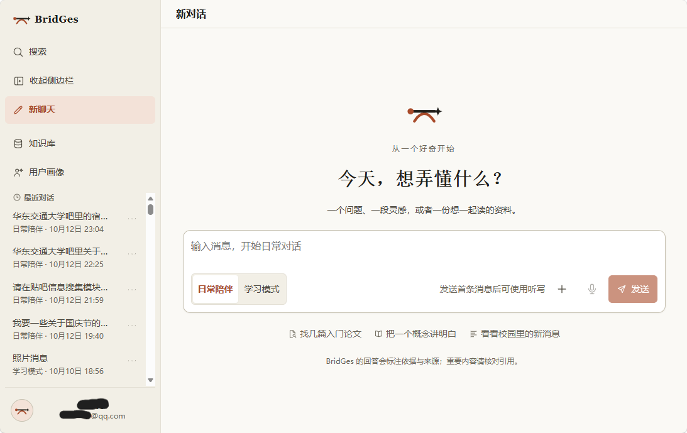

<div align="center">
  
  <h1>BridGes</h1>
  <p>在个人电脑上运行的校园学习助手：日常交流、校园信息、自适应学习，回答标注来源。</p>
  <p>面向华东交通大学学生的使用场景，不核验学籍；账户数据在本机按账户隔离，模型、检索与地图调用外部服务。</p>
  <p>
    <a href="LICENSE"></a>
  </p>
  <p>
    <a href="#快速开始">快速开始</a> ·
    <a href="#可以做什么">功能</a> ·
    <a href="#学习模式">学习模式</a> ·
    <a href="#项目结构与文档">文档</a>
  </p>
  <p>
    
  </p>
</div>

<details>
<summary>目录</summary>

- [为什么是 BridGes](#为什么是-bridges)
- [快速开始](#快速开始)
- [可以做什么](#可以做什么)
- [密钥与模型配置](#密钥与模型配置)
- [Docker / Podman](#docker--podman)
- [数据存放与隐私](#数据存放与隐私)
- [开发与验证](#开发与验证)
- [项目结构与文档](#项目结构与文档)
- [Contributing](#contributing)
- [鸣谢](#鸣谢)
- [License](#license)

</details>

## 为什么是 BridGes

BridGes 把聊天、校园任务和学习辅导放在同一个桌面应用里。它不试图替代通用聊天工具，而是把三类高频校园场景做成可核验的流程：

- **校园任务有明确来源**：论文搜索以 arXiv 为主；校内通勤使用高德路线；贴吧只纳入确认属于“华东交通大学吧”的公开帖子。外部结果不可得时说明缺口，不编造回复或路线。
- **学习围绕理解障碍推进**：学习模式先探查或讲解，在关键概念处用一次一个的理解检查确认是否真的会了；正式判断由后台诊断核对实际作答后写入学习档案，可查看依据、纠正或删除。
- **数据和边界可预期**：账户数据在本机按账户隔离；回答标注来源，补充材料与资料原文分开呈现；模型、检索和地图会调用外部服务，不宣称离线运行。

当前 V2 版本已稳定可发布。日常陪伴保留论文搜索、校园通勤、贴吧信息搜集三个模块；文章人味化、图片/视频生成、旧科学文章创作、旧学习计划写入口和回答朗读已退役，已有结果只读保留并支持导出。

外部服务的真实可得性随网络、额度和供应商状态变化，本地验收不代表长期可用；桌面浏览器是唯一目标环境，不承诺移动端或离线模型。

## 快速开始

在仓库根目录操作。开发环境统一使用 Conda 的 `agent` 环境：Python 3.11、Node.js 24 和 npm。Python 依赖由 `pyproject.toml` 管理，前端依赖由 `apps/web/package-lock.json` 锁定。

**前置条件**

- Windows、macOS 或 Linux 的个人电脑；已安装 Conda（Miniconda 或 Anaconda）；首次安装需要网络。
- Qwen API Key（必需，在[阿里云百炼控制台](https://bailian.console.aliyun.com/)创建）；交互式桌面首启还需要非空的 Tavily API Key（在 [Tavily 控制台](https://app.tavily.com/)创建）；高德 Key 仅在通勤或地图需要时配置（[高德开放平台](https://console.amap.com/dev/key/app)）。
- 3000 和 8000 端口可用；可通过 `BRIDGES_WEB_PORT`、`BRIDGES_API_PORT` 修改。

```powershell
# 首次创建环境
conda env create -f environment.yml
conda activate agent

# 安装后端与开发依赖
python -m pip install -e ".[dev]"

# 启动桌面应用
BridGes start
```

已有 `agent` 环境时，第一步改为 `conda env update -n agent -f environment.yml`，重新激活后再安装 Python 依赖。

**成功标志**

- 终端输出 `API 就绪检查：http://127.0.0.1:8000/health/ready`，接口返回 `ready: pass`。
- 浏览器打开 [BridGes 桌面页面](http://127.0.0.1:3000)。
- 按 `Ctrl+C` 停止应用。

`ready: pass` 只表示本机 API、数据库与运行链路就绪，不代表外部模型、检索或地图服务已通过真实调用验证。

`BridGes start` 会：

1. 创建本机配置和数据目录。
2. 按需执行 `npm ci` 与 `npm run build`。
3. 在交互式终端隐藏询问 Qwen 与 Tavily Key，并保存到操作系统凭据库。
4. 执行数据库迁移，启动 Web、API、后台执行器与旧提醒兼容清理进程。

应用配置不自动读取 `.env`。

常见问题：

- **`No module named bridges`**：仓库移动过或以前从其他工作树安装过时，可编辑安装可能仍指向旧路径；在当前仓库根目录重新执行 `python -m pip install -e ".[dev]"`。
- **首次启动被取消**：交互式首启要求 Tavily Key 非空，直接回车会取消启动；重新运行并输入有效值，或改用非交互启动方式。
- **端口被占用**：默认使用 3000（Web）和 8000（API）；通过 `BRIDGES_WEB_PORT`、`BRIDGES_API_PORT` 调整后再启动。

## 可以做什么

### 日常陪伴与三个模块

新聊天默认进入日常陪伴。直接输入即可普通聊天；也可以点击输入框左侧的 `+` 选择模块，或直接用自然语言提出明确请求——系统按正文识别并启动对应模块，多个能力同样合理时先澄清一个必要问题。选中的模块显示为可移除标签，同一日常会话可以切换模块并保留前文。模块选择是可选辅助，正文意图优先。

| 模块 | 用法示例 | 结果与边界 |
| --- | --- | --- |
| 论文搜索 | “找 Transformer 注意力机制的入门论文” | 以 arXiv 为主检索，提供论文链接、选择理由和阅读顺序；区分摘要信息与实际取得的全文。 |
| 校园通勤 | “从图书馆步行到教学楼” | 按实际定位结果和高德路线返回距离、耗时与地图；支持步行、自行车、电动车，地点或方式不明时先澄清。 |
| 贴吧信息搜集 | “查一下华东交通大学吧里关于宿舍的讨论” | 发现本校贴吧公开帖子；取不到回复时只给帖链，不编造回复总结。 |

外部平台限流、页面不可访问、凭据缺失或证据不足时，模块会说明失败或缺口。校内路线覆盖和贴吧回复尤其依赖当次可得性；本地验收通过不代表这些服务始终可用。详见 [V2 可行性与上线门](docs/v2/feasibility.md)。

### 学习模式

在新聊天右上角选择「学习模式」。纯文字即可开始；照片、PDF、DOCX、TXT、Markdown 等附件和账户知识库都是可选的补充，不再是启动门槛。

- **自适应教学**：先探查理解或给出最小必要提示；缺少前置、持续卡住或你明确要求时直接讲解。一次聚焦一个问题。
- **嵌入式验证**：关键概念通过复述理由、辨别例子或小应用来确认。提问、阅读和说“懂了”不算掌握；单次答对也不推断长期掌握。
- **学习档案**：有价值的作答会触发后台独立诊断，核对实际题目、回答和提示程度后再写入。你可以查看依据、纠正或删除；迟到的诊断不会覆盖你的修改。
- **目标与续学**：具体问题直接辅导；宽泛目标形成简短路线并保存进展，可跨对话继续。临时岔题不改变目标，明确改学才切换。
- **材料与查证**：材料按需读取，明确实际读取范围；论文、时效信息、精确数据或争议结论按需查证。来源不可得时保留缺口，不冒充原文。
- **用户控制**：可以要求完整讲解、跳过验证、暂停或结束；未验证的内容不会被记成已掌握。旧学习记录只读，可在新对话中选择旧材料继续学习。

学习模式与日常陪伴都在首条消息成功创建会话时锁定。已有会话不能中途切换模式，需要新建聊天重新选择。设计背景见 [ADR-0042](docs/adr/0042-adaptive-learning-mode.md) 与 [学习模式重设计 PRD](.scratch/learning-mode-redesign/PRD.md)。

### 附件、知识库与画像

- **聊天附件**：支持 PDF、DOCX、TXT、Markdown 和 PNG／JPEG／GIF／WebP 图片，单个文件不超过 10 MB。可选择文件、拖入或粘贴图片，发送前预览、移除与调整页序。附件归属当前会话，不自动进入知识库。
- **账户知识库**：从侧栏主动上传长期使用的讲义、笔记、简历或教材章节。后台解析后通过关键词与向量混合检索提供相关片段与定位引用。
- **用户画像**：从用户明确表达中提取可复用的原子信息，逐条修改或删除。用户修改优先，删除后的信息不会因重放旧消息自动恢复。
- **历史与数据管理**：保留会话历史、账户隔离、数据导出、备份和删除入口。

V2 已关闭文章人味化专用任务、图片／视频生成、旧科学文章创作、旧版学习计划写入口及回答朗读等退役入口；已有结果仍保留只读查看与导出兼容。自然表达规则直接用于正常回答生成。

## 密钥与模型配置

在账户菜单的设置页管理 Qwen、Tavily、高德凭据及 Qwen 主模型。凭据由当前安装实例管理，并非每个登录账户各自配置一套。

| 配置 | 用途 | 缺失或更新时的行为 |
| --- | --- | --- |
| Qwen API Key | 对话、图片理解、OCR、向量化等模型调用 | 首次启动必须提供；设置页验证候选值成功后才替换。 |
| Qwen 主模型 ID | 主对话、视觉理解与 OCR | 手填精确 ID，经元数据核对和真实能力探测后保存；失败保留原配置。 |
| Tavily API Key | 通用公网检索及依赖它的资料搜集 | 交互式桌面首启要求输入；其他启动方式可缺省，之后在设置页补充。 |
| 高德 Web Service Key | 地点与路线查询 | 未配置时通勤模块提示补充。 |
| 高德 JavaScript Key／安全密钥 | 交互地图展示及代理校验 | 与路线 Key 分开配置。 |

模型切换从下一条消息生效，在途轮次保留启动时的模型，历史回复不会改写。向量模型与索引版本独立固定，不随主模型切换。

设置页验证会调用外部服务；Qwen 凭据更换后 API 就地生效，后台执行器下一轮自动重读生效。由环境变量或 `_FILE` 引用提供的凭据始终优先，在设置页保存新值不会改变实际生效值，页面会如实标注来源；具体边界见 [ADR-0031](docs/adr/0031-runtime-qwen-credential-and-main-model-activation.md)。

自动化部署可使用 `BRIDGES_*` 环境变量或密钥文件引用，例如 `BRIDGES_QWEN_API_KEY_FILE`。显式 `development`／`production` 启动不会执行桌面初始化，需要自行提供数据库、状态密钥和 Qwen 凭据。完整说明见[运行与配置手册](infra/manual/README.md)。

## Docker / Podman

容器使用标准 Python／Node.js 镜像，不需要宿主机安装 Conda。先通过宿主机环境提供 `BRIDGES_QWEN_API_KEY`；Tavily 和高德变量可按需提供。也可挂载密钥文件并使用 `_FILE` 引用，见[配置手册](infra/manual/README.md)。

```powershell
docker compose -f infra/compose/docker-compose.yml up --build
# 或使用 Podman
podman-compose -f infra/compose/docker-compose.yml up --build
```

Compose 启动 Web、API、后台执行器和旧提醒兼容清理进程。API、后台执行器与清理进程共享 `bridges-data` 数据卷；Web 不挂载账户数据。容器中的凭据使用加密卷保存。修改宿主机注入配置后需重建相关容器；不要删除数据卷来升级应用。

## 数据存放与隐私

默认桌面状态目录如下，可在启动前通过 `BRIDGES_HOME` 指定其他目录：

| 系统 | 默认目录 |
| --- | --- |
| Windows | `%LOCALAPPDATA%\BridGes` |
| macOS | `~/Library/Application Support/BridGes` |
| Linux | `$XDG_DATA_HOME/BridGes`，未设置时为 `~/.local/share/BridGes` |

目录中保存桌面配置、本地 SQLite 数据库、加密对象及运行状态。账户数据按稳定账户 ID 隔离；API 凭据保存在系统凭据库或容器加密凭据卷中，不应提交到仓库。账户设置提供数据导出、备份和删除操作；导出备份不包含供应商密钥。

“本地保存”不等于“内容不出本机”：生成回答、OCR 与向量化会向模型服务提交必要材料，搜索与地图会发送必要查询。只面向个人电脑的桌面浏览器，不承诺移动端适配或离线模型运行。

## 开发与验证

以下命令在已激活的 `agent` 环境执行。后端与全仓检查：

```powershell
python -m pip check
python -m pytest -q
python -m ruff check .
python -m mypy src
```

前端安装与单元检查：

```powershell
cd apps/web
npm ci
npm run typecheck
npm run test:unit
npm run build
cd ../..
```

桌面交互验收覆盖 1280×720、1440×900、1920×1080 三个视口。Playwright 默认寻找仓库 `.venv`，使用 Conda 时须明确指定 Python；下面为 PowerShell 示例：

```powershell
$env:BRIDGES_PYTHON = (python -c "import sys; print(sys.executable)")
cd apps/web
npx playwright install chromium
npm run test:e2e -- e2e/issue21-desktop-acceptance.spec.ts
cd ../..
```

验收脚本启动独立测试服务，默认需要 3000／8000 等测试端口空闲。它检查正式 UI、API 与执行器链路；其中的外部来源可能走真实网络，也可能在专用夹具配置下被替代。

测试结果应区分本地功能验证与供应商可得性验证。完整套件出现失败时，请先与同版本基线比较，区分本次改动与既有失败；不要只看整体通过率。

| 命令 | 用途 |
| --- | --- |
| `BridGes start` | 默认桌面启动，自动准备配置与 Web 构建。 |
| `BridGes start --profile development` | 使用预先提供的运行配置，启动前端开发服务器。 |
| `BridGes api` / `BridGes web --dev` / `BridGes worker` | 分进程运行；API 与后台执行器需要完整运行配置。 |
| `BridGes scheduler` | 运行提醒调度与旧提醒兼容清理进程。 |
| `BridGes doctor` | 检查当前进程读取到的配置；不会自动加载桌面 `config.json`。 |
| `BridGes migrate` | 对当前配置的数据库执行迁移。 |
| `BridGes evaluate` | 可复现 A/B 科学评测：运行、重放、盲评、报告与发布门判定。 |
| `BridGes profile-replay` | 画像回放工具链：检查数据库身份、备份、试运行、回放与受监督 worker。 |

## 项目结构与文档

| 路径 | 内容 |
| --- | --- |
| `apps/web/` | Next.js／React 桌面前端、组件测试与 Playwright 验收。 |
| `src/bridges/` | FastAPI、CLI、LangGraph 对话编排、三个日常模块、学习流程、存储与检索。 |
| `packages/contracts/`、`openapi.json` | 前后端共享的 API 契约及生成类型。 |
| `tests/` | 后端单元、契约、集成与迁移测试。 |
| `infra/`、`scripts/` | 容器与手动运行配置、诊断及验收脚本。 |
| `docs/v2/`、`docs/adr/` | V2 设计基线与架构决策。 |
| `.scratch/bridges-v2/issues/` | V2 本地任务与实现验收记录。 |

V2 文档包含设计基线与历史决策；当前行为以本 README 和实际验收为准。

- [V2 文档索引](docs/v2/README.md)：产品、交互、工作流、架构与交付计划。
- [产品契约](docs/v2/product-contract.md)、[ADR-0030](docs/adr/0030-v2-campus-assistant-and-approved-desktop-interaction.md)、[ADR-0031](docs/adr/0031-runtime-qwen-credential-and-main-model-activation.md)：产品边界与凭据／模型规则。
- [运行与配置手册](infra/manual/README.md)：进程、环境变量、凭据与容器配置。
- [领域上下文](CONTEXT.md)与[数据表归属](docs/table-owners.md)：领域边界与存储责任。
- [桌面设计规范](DESIGN.md)：界面视觉规范。
- [学习模式 ADR-0042](docs/adr/0042-adaptive-learning-mode.md)与[重设计 PRD](.scratch/learning-mode-redesign/PRD.md)：自适应学习的目标与验收合同。
- [任务跟踪约定](docs/agents/issue-tracker.md)：本仓库使用 `.scratch/` 下的本地 Markdown 跟踪任务。

## Contributing

欢迎提交 PR；问题与任务按 [issue-tracker](docs/agents/issue-tracker.md) 约定在 `.scratch/` 中记录。提交前请运行「开发与验证」中的检查。

## 鸣谢

BridGes 站在这些开源项目的肩膀上。以下项目提供了思路、接口或生态参考；具体实现仍按本项目边界完成，不代表存在合作或背书关系。

- [powercontext](https://github.com/oceanbase/powercontext)
- [giftia](https://github.com/wenbo-zhang1/giftia)
- [DeepTutor](https://github.com/HKUDS/DeepTutor)
- [Socratic-Education-System](https://github.com/HowieWang1121/Socratic-Education-System)
- [aiotieba](https://github.com/lumina37/aiotieba)
- [MediaCrawler](https://github.com/NanmiCoder/MediaCrawler)
- [paperseek](https://github.com/paperseek/paperseek)

## License

本项目采用 [Apache-2.0 许可证](LICENSE)。
